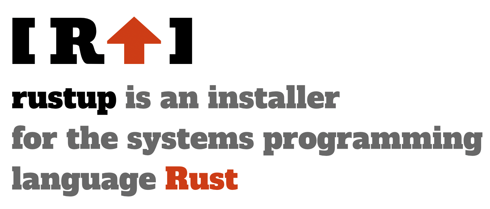

+++
title = "Rust Maintainer Monthly Report: November 2026"
pubDate = "2026-11-25"
description = "Dive even deeper into rustup: checkpoints and milestones"

tags = ["Rust", "rustup"]
+++

> This post belongs to a series of monthly reports about my daily work on Rust
> as a full-time [MiR][Maintainer in Residence] with a focus on [rustup]. Please
> feel free to check out my previous posts on [`#rustup`] as well if you are
> curious about the background :)

[rustup]: https://github.com/rust-lang/rustup
[`#rustup`]: /tags/rustup
[Maintainer in Residence]:
  https://rust-lang.github.io/rfcs/3931-rfmf-rust-foundation-maintainer-fund.html#expectations-placed-on-maintainers-in-residence

## Overview

It's the 4th month into my MiR mission, and I am glad to say that this has been
one of my most productive months so far. I have been able to make quite some
progress on multiple fronts.

## Maintenance

The headline of this month is that the rustup v1.29.3
[stable release](https://blog.rust-lang.org/2026/11/03/Rustup-1.29.3) happened
earlier this month in response to minor upstream regressions caused by the
previous dot release.

Apart from that, within this month, I have mainly worked on some minor refactors
and QoL improvements, with frequent small PRs being merged into mainline from
time to time. These efforts include and are not limited to the following:

- [rustup#3607]: Improvements to error reports when fetching version strings
  from `rustc` calls. The relevant work also included strengthening rustup's
  timeout guarantees for subprocess calls to avoid hangs in case of misbehaving
  subprocesses.
- [rustup#5190]: Reuse of the infrastructure provided by `DownloadCfg` for
  self-updates to achieve proper retrying and hash checking of rustup itself,
  which should be very helpful on unstable network connections.
- [rustup#5211]: Strengthening rustup's test harness to fix regressions caused
  by the breakage of `cargo` target layout in Rust v1.100.0. The relevant work
  also included an optimization of putting the test temporary directories under
  the OS' temporary directory instead of the current working directory for
  better performance and less clutter.
- [rustup#5224]: Continuation of the simplifying efforts of the `*Toolchain*`
  type hierarchy in the rustup codebase.

[rustup#3607]: https://github.com/rust-lang/rustup/issues/3607
[rustup#5190]: https://github.com/rust-lang/rustup/pull/5190
[rustup#5211]: https://github.com/rust-lang/rustup/pull/5211
[rustup#5224]: https://github.com/rust-lang/rustup/pull/5224

### PR Farming and the Churn

Since a few months ago, I have been noticing a very dangerous trend coming up in
my management of rustup issues and external contributions: certain PR authors
are farming the issues with an LLM, which then spits out poorly-written PRs
trying to address them. Meanwhile, they have nearly no willingness to properly
read the review feedback, hoping that at least a few of them would be simple
enough to pass the numbers game and get merged.

This month, the situation has only escalated. Instead of scraping the issues and
moving on with them, I have reasons to believe that they started turning to the
rustup codebase itself and suggesting fixes simply by looking at the codebase
with an LLM and pointing out what could have been wrong. As a matter of fact, in
this very month, two individuals have come up with the same report on one
particular issue within a timespan of a day or two.

Oftentimes, what they point out is technically correct, but not necessarily
helpful: first, such issues/PRs often come with limited context or background
(which is understandable since the reports are not coming from real-world usage,
but they will definitely complicate the review process); second, the issues
being discovered are often minor and could have been left as exercises for
future interested participants to work on; and third, this has left a noticeable
bandwidth gap between the production of issues/PRs and their review.

I don't currently have a strategy dealing with this situation yet, but I see
this as a case that may be generalized to other places, and for a project like
rustup where the overall bandwidth of the maintainers has just floated above the
acceptable threshold, a possible alarming signal. [^contact]

[^contact]:
    If you have any suggestions or experiences to share in this regard, please
    feel free to reach out to me on
    [Zulip](https://rust-lang.zulipchat.com/#narrow/dm/616990-rami3l)!

## Project Goals

### [Process-Safe Rustup](https://rust-lang.github.io/goals/2026/process-safe-rustup.html)

A quick recap before going into the technical details: in today's rustup, a
toolchain is defined as an unarchived (or linked) subdirectory under the
`toolchains/` directory that contains the actual toolchain contents. With the
new transactional semantics, however, the notion of a "toolchain" is split into
two parts: an object that actually holds its contents in the form of a
(pseudo-)content-addressed subdirectory under the `heap/` directory, and one or
multiple references in the form of filesystem links pointing to that object
located under `toolchains/`. This way, we can achieve cross-platform atomicity
and process-safety of toolchain modifications by spawning the resulting object
and references in a temporary directory and then atomically moving them to their
final destination.

As outlined in the previous design documents, the second iteration of the [PoC]
is finally approaching the finish line. I have made even more exciting
advancements this month based on my
[prior work](../rust-worklog-2026-10/#project-goals):

Firstly, I have finally made a new patch [rustup#5194] to gather as many
different incarnations of [rustup#988] – the very issue from 2017 that this
project goal is aiming to resolve – as I can, and it is now able to stably
reproduce them with test cases using an evolved version of [`@cachebag`]'s
"checkpoint" testing framework!

As you can probably imagine, this is a major breakthrough in the resolution of
the issue, because `t-rustup` has only been able to randomly do the guesswork to
mark new issues as duplicates of it without concrete evidence over the past
_decade_, simply due to the variety of these incarnations. Better yet, stacking
my PoC on top of these test cases results in every single test snapshot being
flipped to the correct side, verifying the validity of my work so far 🎉

Secondly, the garbage collection of in-flight objects and references has been
implemented. I have decided to merge it with the GC of unreachable objects,
since both actions would require acquiring the dummy filesystem mutex
corresponding to a certain object address. Since new objects and references are
created in a temporary directory in a randomized location, this feature ensures
that they are properly cleaned up in case of interruption and thus the disk
usage will no longer grow indefinitely.

Finally, I have drafted the overall design of migrating an existing rustup
installation to the new heap-based layout required by this change. In short, the
intended migration process is as transparent as it can be: once the "new rustup"
discovers an "old-style" toolchain, it will be able to uninstall it and
reinstall it under the new layout instead of the regular toolchain update
process. This way, you won't have to pay the overhead of migrating a whole
rustup installation at once, as the migration will be performed one toolchain at
a time.

With these achievements, the PoC stage has only one milestone left: the actual
implementation of that migration! I will leave it for the rest of this year, but
I am confident that it will be a smooth process.

[PoC]: https://github.com/rami3l/rustup/pull/2
[`@cachebag`]: https://github.com/cachebag
[rustup#988]: https://github.com/rust-lang/rustup/pull/988
[rustup#5194]: https://github.com/rust-lang/rustup/pull/5194

## Community Building

I have made two major proposals for rustup on the community building front this
month:

The first is a logo for rustup. I came up with this idea in a crowded Shenzhen
metro carriage when I was there
[last month](../rust-worklog-2026-10/#community-building) hoping to further
promote the project and unite its team, and that is why I started a heated
[discussion] on the rustup Zulip channel regarding this idea this month. I was
super fortunate to have received the help from my friend [`@lynzrand`] to come
up with a few different designs, and here is a sneak peek of the community's
favorite so far, and I'm super excited if it gets adopted eventually:

The second is a proposal to add a charter for the rustup team. The [call for
chartering work] was issued as part of the Rust 2021 roadmap, but the rustup
team at the time never had the bandwidth to finalize it. As rustup's community
and especially its contributor base grow, it is increasingly important to have a
clear charter to define the mission, scope, as well as membership and
decision-making policies of the team to bring more transparency and clarity
regarding the team's work. In that pursuit, I have [drafted a new charter] for
the rustup team based on the draft `wg-rustup` charter with different
inspirations brought from the charters of `t-cargo` and `t-clippy`. I'm actively
looking forward to the community's feedback and hope to be able to finalize it
in the upcoming weeks.

[`@lynzrand`]: https://github.com/lynzrand
[discussion]:
  https://rust-lang.zulipchat.com/#narrow/channel/490103-t-rustup/topic/A.20logo.20for.20the.20rustup.20project.3F/with/640902372
[call for chartering work]:
  https://github.com/rust-lang/rfcs/blob/main/text/3037-roadmap-2021.md#chartering-work-in-the-rust-project
[drafted a new charter]: https://github.com/rust-lang/rustup/pull/5258

## Conclusion

I would like to express my gratitude to the Rust Foundation, [`t-funding`], and
[`t-rustup`] for their continued support and trust, as well as everyone else
contributing their verse to rustup and Rust in general, without your efforts
this wouldn't have been possible!

Many thanks for reading this post, and I'll see you in the next one!

[`t-funding`]: https://rust-lang.org/governance/teams/#team-funding
[`t-rustup`]: https://rust-lang.org/governance/teams/#team-rustup
